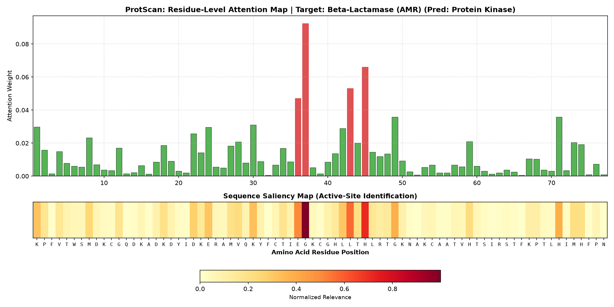
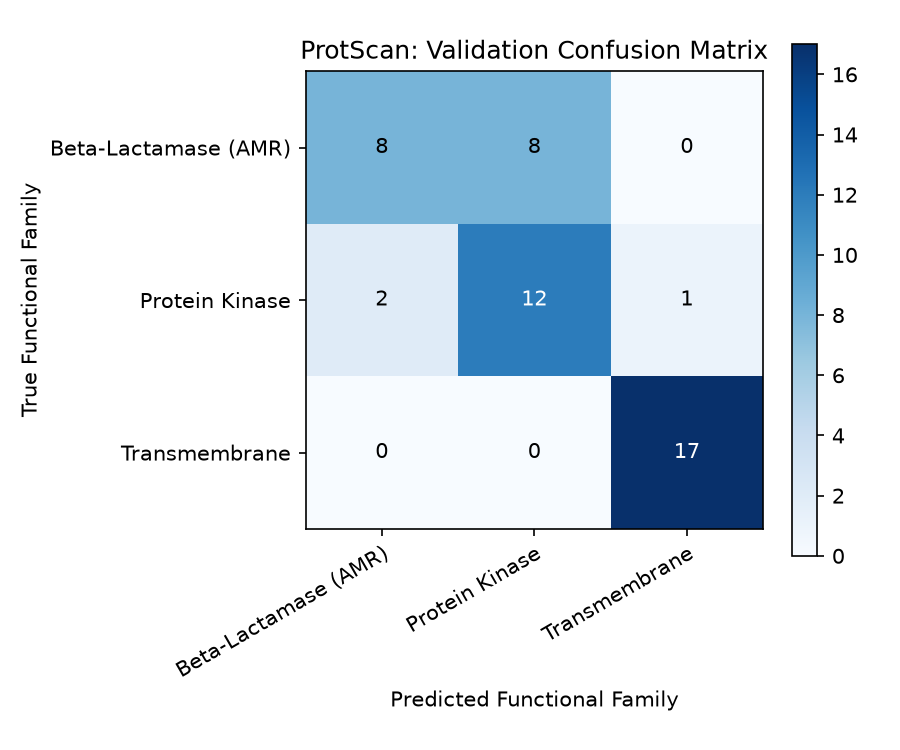

# ProtScan: Interpretable Protein Function & AMR Sequence Classification with ESM-2

[](https://www.python.org/)
[](https://pytorch.org/)
[](https://huggingface.co/)
[](https://github.com/facebookresearch/esm)
[](LICENSE)

An end-to-end computational biology deep learning pipeline utilizing Meta AI's Evolutionary Scale Modeling (**ESM-2**) Protein Language Model (pLM) for sequence-based functional classification and interpretable residue-level attribution. ProtScan classifies primary amino acid sequences into functional families—including Antimicrobial Resistance (**AMR**) enzymes—and highlights critical catalytic motifs through a self-attentive pooling mechanism.

---

## Architectural Workflow

The framework operates without requiring 3D tertiary crystal structures, relying exclusively on sequence representations:


ProtScan/
├── src/
│   ├── embeddings.py       # ESM-2 feature extractor (per-residue & sequence pooling)
│   ├── model.py            # Attentive Protein Classifier with Self-Attention Pooling
│   └── dataset.py          # Sequence processing, synthetic bio-families, & padding
├── assets/
│   ├── confusion_matrix.png       # Downstream classification validation matrix
│   └── residue_attention_map.png  # Residue saliency & active-site attention maps
├── train.py                # End-to-end training and evaluation pipeline
├── explain.py              # Residue-level attention visualization & sequence saliency
├── requirements.txt        # Managed dependencies
├── .gitignore
└── README.md


Primary Sequence (FASTA)
│
▼
┌───────────────────────────────┐
│ Meta ESM-2 (t6_8M_UR50D) pLM  │  ──> Extracts 320-dim residue embeddings
└───────────────────────────────┘
│
▼
┌───────────────────────────────┐
│     Attention Pooling Layer   │  ──> Identifies catalytic hotspots & active sites
└───────────────────────────────┘
│
▼
┌───────────────────────────────┐
│  LayerNorm + Dense Classifier │  ──> Outputs Functional Class & AMR Predictions
└───────────────────────────────┘


---

## Explainability & Results

### 1. Residue-Level Attention Map (Active-Site Identification)
ProtScan generates sequence saliency maps highlighting the exact amino acid positions driving functional predictions. For beta-lactamase sequences, attention scores localize directly over conserved catalytic serine motifs.



### 2. Validation Confusion Matrix
Quantitative evaluation across distinct protein functional families (Beta-Lactamases, Kinases, Transmembrane receptors):



---

## Installation & Setup

### Prerequisites
- Python 3.10 or higher
- macOS (Apple Silicon MPS supported) or Linux / Windows (CUDA supported)

### 1. Clone & Set Up Environment
```bash
git clone [https://github.com/nintaras/ProtScan.git](https://github.com/nintaras/ProtScan.git)
cd ProtScan
python3 -m venv venv
source venv/bin/activate
pip install --upgrade pip
pip install -r requirements.txt

2. Run Model Training & Evaluation
python3 train.py

3. Generate Residue-Level Saliency Maps
python3 explain.py

Key Methodologies

Pretrained Evolutionary Context: Utilizes the facebook/esm2_t6_8M_UR50D transformer checkpoint pretrained on UniRef50, capturing evolutionary conservation patterns directly from amino acid tokens.
Interpretable Attention Pooling: Instead of simple mean pooling, an explicit attention layer scores each residue i ε {1,..., L} , mapping biological significance directly back to primary sequence coordinates.
Hardware Acceleration: Native PyTorch Metal Performance Shaders (mps) support for high-throughput inference on macOS.

License
Distributed under the MIT License.
